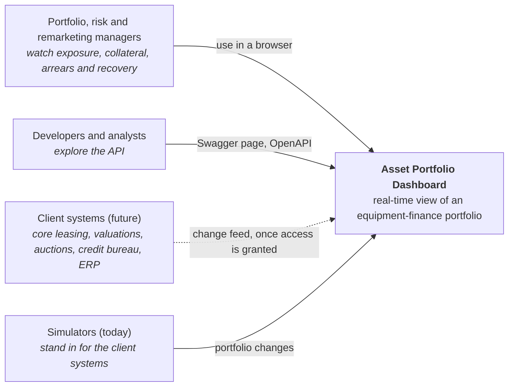
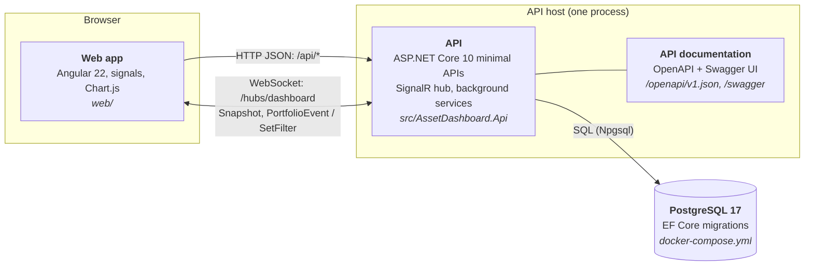
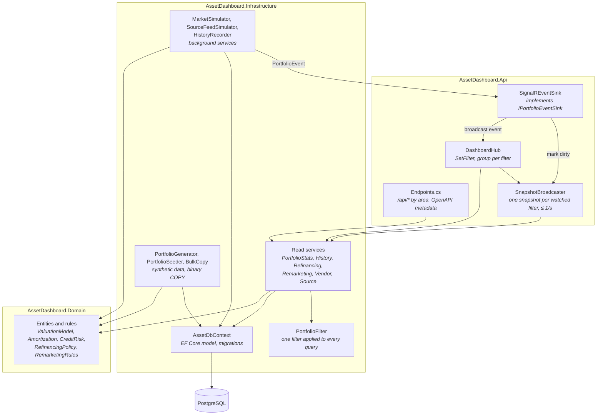
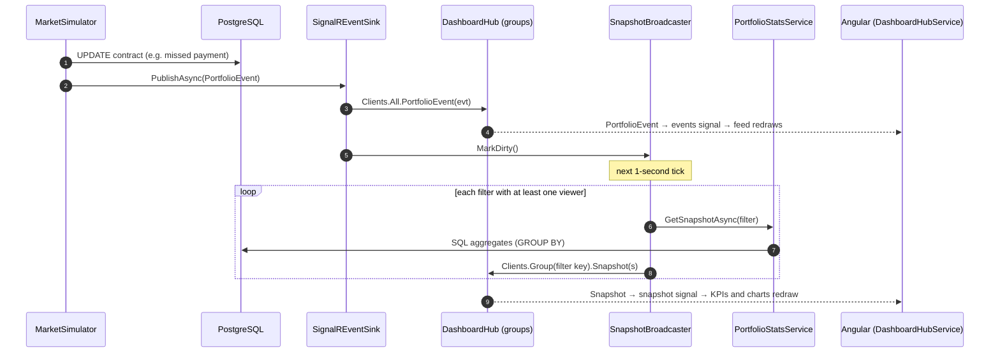

# Architecture

This document describes the system at three zoom levels (C4: context, containers, components),
follows one live update from end to end, and explains the main design decisions. Code-level
walkthroughs are in [backend-guide.md](backend-guide.md) and [frontend-guide.md](frontend-guide.md);
the reasoning behind each choice is in the [decision records](adr/README.md).

## Level 1: System context

Who uses the dashboard and which systems it depends on.

Today all data is synthetic: generators seed the database and simulators change it live. The
[integration options](#from-simulator-to-real-data) describe how the client's systems replace them.

## Level 2: Containers

What runs, and how the parts talk to each other.

| Container | Technology | Responsibility | Runs as |
|---|---|---|---|
| Web app | Angular 22 (standalone components, signals, zoneless), Chart.js, `@microsoft/signalr` | Screens, filters, charts; keeps one SignalR connection | `npm start` (dev server on :4200, proxies `/api` and `/hubs`) |
| API | .NET 10, ASP.NET Core minimal APIs, SignalR, EF Core 10 + Npgsql | REST endpoints, live push, statistics, simulators, seeding | `dotnet run --project src/AssetDashboard.Api` (:5080) |
| API documentation | Microsoft.AspNetCore.OpenApi, Swashbuckle Swagger UI | Generated from the endpoint metadata; try-it-out | Same process, `/swagger` |
| Database | PostgreSQL 17 | Read model: contracts, assets, valuations, recoveries, history, loads | `docker compose up -d`, or by the Aspire AppHost |
| Orchestration | .NET Aspire 13 (AppHost, ServiceDefaults) | Starts everything together; dashboard for traces, metrics, logs | `dotnet run --project src/AssetDashboard.AppHost` |

## Level 3: Components of the API

Inside the API process. Arrows point from caller to callee.

**Dependency rule:** Domain depends on nothing; Infrastructure depends on Domain; Api depends on
both. Domain holds the business rules as pure functions (unit-tested without a database);
Infrastructure holds everything that touches the database or runs in the background; Api holds
only transport (HTTP, SignalR) and hosting.

| Project | Contents | Depends on |
|---|---|---|
| `AssetDashboard.Domain` | Entities, enums, pure business rules | none |
| `AssetDashboard.Infrastructure` | EF Core model and migrations, read services, filter, generators and seeding, simulators | Domain, EF Core, Npgsql, ASP.NET Core hosting abstractions |
| `AssetDashboard.Api` | Endpoints, SignalR hub and broadcaster, startup | Infrastructure, Domain |
| `tests/AssetDashboard.Tests` | Unit tests (domain rules, generator, filter) | Domain, Infrastructure |
| `tests/AssetDashboard.IntegrationTests` | The real API against a throwaway Postgres (Testcontainers) | Api |

The web app's components are described in [frontend-guide.md](frontend-guide.md#structure).

## A live update, end to end

What happens between a change in the portfolio and the figure moving on screen.

When the user changes a filter, the client calls `SetFilter(filter)`; the hub moves the
connection to that filter's group and replies at once with a cached or freshly computed snapshot.
The client ignores any snapshot whose filter no longer matches its own (a late message for the
previous filter).

## Real-time design

There are two message types on one hub (`DashboardHub`). Data flows **server → client**; the
only client → server call is `SetFilter`.

| Message | When | Payload |
|---|---|---|
| `PortfolioEvent` | Every individual change | Small: type, message, ids, amount |
| `Snapshot` | At most once per second, only if something changed (and at least every 30 s) | Full `PortfolioSnapshot` with all KPIs and breakdowns, for the connection's filter |

**Why a throttled snapshot rather than pushing deltas?** Recomputing the aggregates is a handful
of SQL `GROUP BY`s over indexed columns. Changes are coalesced (a dirty flag checked every
second), so a burst of 1,000 events still costs one recompute. Clients stay simple: the latest
snapshot is the whole truth. When a client connects, it immediately gets the latest snapshot plus
the last 50 events.

**Global filters:** each connection watches one `PortfolioFilter` (asset class, country, vendor,
product, underwater only) and belongs to the SignalR group named after the filter's key. The
broadcaster keeps one snapshot per filter that at least one client watches, recomputes them when
the portfolio changes, and sends each to its group. Clients sharing a filter share the work. A
filter nobody watches any more is dropped. Events go to everyone; the client narrows them by
category and asset class.

**Scaling out:** with more than one API instance, add the SignalR Redis backplane
(`AddStackExchangeRedis`) or Azure SignalR Service. Only one instance should run the snapshot
recompute (leader election), or the snapshot can be moved to a separate worker.

## Backend services per view

Each screen (built or planned) has a read service in `AssetDashboard.Infrastructure` and its
endpoints under `/api`. Every service takes the same `PortfolioFilter`, so filters behave the same
everywhere. All endpoints are documented at `/swagger`.

| Service | Screen | Endpoints |
|---|---|---|
| `PortfolioStatsService` | Overview, asset explorer | `/dashboard/snapshot`, `/assets`, `/assets/{id}`, `/assets/export`, `/reference` |
| `PortfolioHistoryService` + `HistoryRecorder` | Trend charts (planned) | `/history` |
| `RefinancingService` | Refinancing (planned) | `/refinancing/summary`, `/requests`, `/candidates` |
| `RemarketingService` | Remarketing (planned) | `/remarketing/summary`, `/cases`, `/auctions` |
| `VendorService` | Vendors (planned) | `/vendors`, `/vendors/{id}` |
| `SourceService` + `SourceFeedSimulator` | Data sources (planned) | `/sources`, `/sources/{id}/runs` |

The services contain no business rules. These sit in the domain project and are unit-tested
there: `CreditRisk` (PD, LGD, expected loss), `RefinancingPolicy` (credit decision),
`RemarketingRules` (storage rates, selling fees, hammer price), `ValuationModel` and
`Amortization` (asset values, repayment schedules).

## From simulator to real data

The client's asset database isn't available yet. `MarketSimulator` stands in for it by changing
the local Postgres database. Options for the real integration, roughly in order of preference:

1. **Change data capture (CDC):** Debezium (or SQL Server CDC, if the source is SQL Server)
   streams row changes to Kafka, Azure Event Hubs or Service Bus. A consumer `BackgroundService`
   maps them to `PortfolioEvent`s and marks the snapshot dirty. This is near real-time and
   decoupled from the source system.
2. **Domain events from the source application:** if the client's systems already publish
   business events (e.g. "asset revalued"), subscribe to them directly.
3. **Postgres `LISTEN/NOTIFY`:** triggers on the replicated tables call `pg_notify`. This is
   simple, but only works when the dashboard reads a Postgres copy.
4. **Polling** on an `UpdatedAt` or rowversion column. This is the simplest option and is
   acceptable for refresh intervals of 30 seconds or more.

In every case, the integration only needs to (a) keep the read model in Postgres up to date and
(b) call `IPortfolioEventSink.PublishAsync`. Screens, endpoints and the real-time pipeline stay
unchanged.

## Observability

`AssetDashboard.ServiceDefaults` (referenced by the API) configures OpenTelemetry for logs, traces
and metrics, and the health endpoints `/health` and `/alive`. Telemetry is exported over OTLP when
`OTEL_EXPORTER_OTLP_ENDPOINT` is set, which the Aspire AppHost does; in production the same export
can go to Azure Monitor, Grafana or any OTLP backend.

| Signal | Sources |
|---|---|
| Traces | ASP.NET Core requests, SignalR hub calls, SQL (Npgsql), and the app's own spans: `snapshot.recompute` (tagged with the filter), `simulator.step` |
| Metrics | ASP.NET Core, Kestrel, SignalR connections, Npgsql, .NET runtime, and the app's own (`AssetDashboardTelemetry`): `assetdashboard.snapshot.duration`, `.snapshots.sent`, `.events.published`, `.filters.active`, `.simulator.steps`, `.source.loads` |
| Logs | All `ILogger` output, structured, correlated with traces |

`AssetDashboard.AppHost` starts PostgreSQL, the API and the Angular app together and shows all of
this in the Aspire dashboard. A trace of one snapshot recompute shows its ten SQL queries and their
timings, which is how slow queries are found.

## Large datasets

- Aggregation runs in Postgres (`GROUP BY` with indexes on `Status`, `AssetClass`,
  `DaysPastDue` and `MaturityDate`). No rows are loaded into memory for KPIs.
- Lists are paged on the server; sorting happens on entities before projection (EF Core cannot
  sort on a projected record).
- Seeding streams contracts in chunks and writes them with binary `COPY`: 1,000,000 contracts
  (1.57M assets, 5.7M valuations) in 2 min 20 s.
- **Known limit (SCRUM-60):** at 1M contracts, queries that sum asset values per contract are
  slow (underwater filter 20 s, vendor list 14 s, refinancing summary 8.5 s, LTV sort 5.6 s).
  Planned fix: store collateral totals on the contract, or a materialised view.

## Technology choices

| Choice | Why | Decision record |
|---|---|---|
| .NET 10 (LTS) | Cross-platform; runs on macOS for development and on Windows or Linux in production | [ADR 0001](adr/0001-dotnet-10-minimal-apis.md) |
| Minimal APIs | Less ceremony than controllers for a read-heavy API | [ADR 0001](adr/0001-dotnet-10-minimal-apis.md) |
| SignalR, snapshot per filter group | Built-in real time with reconnects; one recompute per filter, not per viewer | [ADR 0002](adr/0002-signalr-throttled-snapshots-per-filter.md) |
| Angular with signals | Common in enterprise; signals make live data simple | [ADR 0003](adr/0003-angular-signals.md) |
| PostgreSQL + EF Core | Open source, migrations, strong SQL aggregation | [ADR 0004](adr/0004-postgresql-ef-core.md) |
| Domain rules as pure functions | Testable without a database; services stay thin | [ADR 0005](adr/0005-domain-rules-as-pure-functions.md) |
| Synthetic data and simulators | Work and demo before client access; deterministic per seed | [ADR 0006](adr/0006-synthetic-data-and-simulators.md) |
| Testcontainers integration tests | Real database in tests; catches query-translation errors | [ADR 0007](adr/0007-integration-tests-with-testcontainers.md) |
| Binary COPY seeding | 1M contracts in minutes with flat memory | [ADR 0008](adr/0008-bulk-seeding-with-copy.md) |
