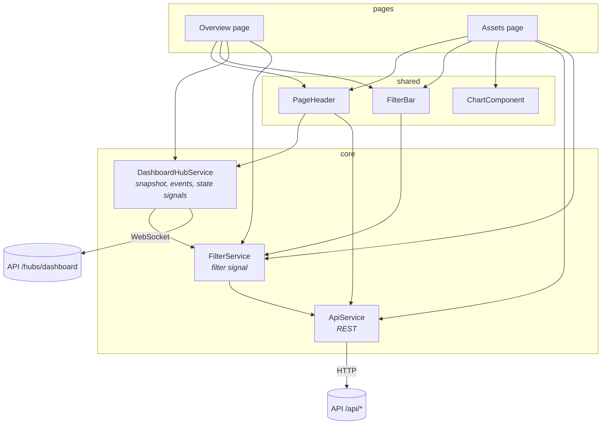

# Frontend guide

A walkthrough of the Angular app in `web/`: how it boots, where state lives, how live data
reaches the screen, and how to extend it. Read [architecture.md](architecture.md) first for the
big picture.

## Stack

| Piece | Choice |
|---|---|
| Framework | Angular 22: standalone components, signals, zoneless change detection, built-in control flow (`@if`, `@for`) |
| Routing | Angular Router with lazy-loaded pages and query-parameter input binding |
| Real time | `@microsoft/signalr` (one connection per browser tab) |
| HTTP | `HttpClient` with the `fetch` backend |
| Charts | Chart.js (wrapped in one component); most bars are plain HTML/CSS |
| Fonts | IBM Plex Sans and Mono, self-hosted through `@fontsource` (no calls to Google) |
| Tests | Vitest (Angular's unit-test builder); end-to-end tests with Playwright for .NET in `tests/AssetDashboard.EndToEndTests` |

Run it with `npm start` (dev server on :4200). `proxy.conf.json` forwards `/api` and `/hubs`
(WebSocket included) to the API on :5080, so the app uses relative URLs and needs no CORS.

## Structure

```
web/src/
  main.ts                 bootstraps App with appConfig
  styles.scss             design tokens (light and dark) and all component styles
  app/
    app.config.ts         providers: error listeners, HttpClient (fetch), Router (input binding)
    app.routes.ts         '' → Overview, 'assets' → Assets (both lazy-loaded)
    app.ts / app.html     shell: sidebar navigation + <router-outlet>; starts the hub connection
    core/                 state and data access, no UI
      models.ts           TypeScript mirror of the API records (enums as string unions)
      api.service.ts      REST calls; turns a filter into query parameters
      filter.service.ts   the global filter (signal), reference data, filter chips
      dashboard-hub.service.ts  SignalR connection; snapshot and events as signals
      format.ts           euro, percent and number formatting; humanize enum names
    shared/               reusable UI
      page-header.ts      title, breadcrumb, live status, pause/resume feed, projected actions
      filter-bar.ts       the global filter controls and the open-contracts count
      chart.ts            Chart.js wrapper + chart theme read from CSS tokens
      icon.ts             inline stroke icons by name
    pages/
      overview/           KPIs, exposure vs collateral, delinquency, recovery, vendors,
                          refinancing watchlist, countries, live events, CSV export
      assets/             asset explorer: search, status, sort, paging, CSV export, detail panel
```



## State: three services, all signals

The app is zoneless: the screen updates when a signal it reads changes. All shared state is in
three root services.

**`FilterService`** holds the global filter as a signal (`filter`), plus `reference` (vendors and
countries for the dropdowns, loaded once), `chips` (removable labels for the active filter) and
`summary` (the breadcrumb text). Change it with `patch({...})`, `toggle(key, value)` (click once
to filter, again to clear: the drill-down behaviour) or `reset()`. Every page reads the same
filter, so a filter set on the overview still applies on the asset explorer.

**`DashboardHubService`** owns the one SignalR connection.

- `snapshot` holds the latest `PortfolioSnapshot`; `events` the last 100 events, newest first;
  `state` the connection state (connecting, connected, reconnecting, disconnected).
- An `effect` sends `SetFilter(filter)` whenever the filter changes, and again after every
  reconnect (a new connection starts unfiltered on the server).
- A snapshot whose `filter` does not match the current filter is ignored, so a late message for
  the previous filter never overwrites the new one. `pending` is true until the matching snapshot
  arrives; the filter bar shows a progress line and the page dims meanwhile.
- If the connection drops, SignalR reconnects automatically; if it closes, the service retries
  every 5 seconds.

**`ApiService`** wraps the REST endpoints (reference data, asset list, asset detail, CSV export
URL, simulator state). `filterParams` turns the filter into query parameters; only set values are
sent.

## Pages

### Overview (`pages/overview`)

Everything on the page derives from `hub.snapshot` through `computed` signals that build small
view models: KPI cards with their context bars, class rows with bar widths scaled to the largest
value, past-due composition, recovery bars, top vendors, and the watchlist (classes with LTV above
100%). The page fetches nothing itself; it redraws whenever a new snapshot arrives.

- **Drill-down:** clicking an asset class row, a vendor or a country chip calls
  `filters.toggle(...)`. The hub service sends the new filter and the matching snapshot replaces
  the page's data.
- **Live events:** `hub.events`, narrowed by the category buttons (Credit, Valuations,
  Remarketing) and by the asset-class filter. Labels and colours come from `EVENT_STYLE`; event
  types the page does not know still render with a neutral label.
- **Export** builds a CSV of the KPIs, asset classes and delinquency in the browser.
- "View past-due contracts" links to `/assets?sort=DaysPastDue`.

### Asset explorer (`pages/assets`)

- A `query` computed signal combines the global filter, status, search, sort and page; an
  `effect` reloads the list whenever it changes. A request counter drops responses that arrive
  after a newer request, so fast typing never shows stale rows.
- Search is debounced by 300 ms; changing the global filter returns to page 1.
- The initial sort can come from the URL (`?sort=DaysPastDue`) through router input binding.
- Selecting a row loads `/api/assets/{id}`. The detail panel shows the facts, a Chart.js line
  chart of market value, forced sale value and the asset's share of the exposure over time, and a
  plain-language collateral-cover sentence.
- Export CSV links to `/api/assets/export` with the same query, so the file matches the table.

## Shared components

| Component | Notes |
|---|---|
| `PageHeader` | Breadcrumb shows the filter summary; live pill shows Live, Paused, Reconnecting or Offline with the last update time; pause/resume calls the simulator endpoints; page actions are projected with `<ng-content>` |
| `FilterBar` | Segmented "All contracts / Underwater only", dropdowns for class, country, vendor, product; "Clear filters"; open contracts and assets from the snapshot |
| `ChartComponent` | Creates the Chart.js instance once and updates it in place when the `config` input changes; destroyed with the component. `chartTheme()` and `baseOptions()` read colours from the CSS tokens, so charts follow light and dark mode |
| `Icon` | Inline SVG paths by name; decorative (`aria-hidden`), always next to text or inside a labelled button |

## Styling

`styles.scss` defines design tokens as CSS custom properties: surfaces, text, borders, the two
series colours, status colours, the sidebar. Dark mode redefines the same tokens (following the
operating system, or `data-theme` on `<html>`). Components use the tokens, never raw colours.

Conventions behind the look:

- Series colours (exposure blue, collateral orange) come from a colour-blind-safe palette.
- Status colour is never the only signal: pills always carry a text label (Default, Missed
  payment, Sold); underwater LTV also shows an arrow icon.
- Numbers use tabular figures in tables and KPI cards so columns line up.
- Below 960 px the sidebar becomes a top bar; below 640 px fields stack and tables scroll inside
  their card, so the page never scrolls sideways.

## Data contracts

The API's types are **generated**, not written by hand. The contract is the OpenAPI document
committed at `contracts/openapi.v1.json`; `npm run api:generate` turns it into
`core/api.generated.ts` (openapi-typescript, run through `npx` at a pinned version because it
declares support for TypeScript 5 only). `core/models.ts` gives the generated types short names
(`PortfolioSnapshot`, `AssetListItem`, ...) and adds the few client-side types.

Compile-time checks in `models.ts` fail the build when the hand-written parts drift: the dropdown
option lists must contain exactly the contract's enum values, the app's `PortfolioFilter` must be
sendable as the API's filter, and `PagedResult<T>` must match the contract's paged results.

When the API changes on purpose:

1. Run the backend tests with `UPDATE_API_CONTRACT=1` (rewrites `contracts/openapi.v1.json`).
2. `cd web && npm run api:generate`, then fix any compile errors the new types reveal.
3. Commit the contract, the generated file and the fixes together.

`npm run api:check` regenerates into a temporary file and fails if it differs from the committed
`api.generated.ts` (used by CI).

## Recipes

### Add a page

1. Create `pages/<name>/<name>.ts` and `.html` as a standalone component; use `PageHeader` and
   `FilterBar`.
2. Add a lazy route in `app.routes.ts` and give its sidebar entry a `link` in `app.ts`.
3. Read the filter from `FilterService`; call the page's endpoint through `ApiService` (add a
   method; name the generated types you need in `models.ts`).
4. Derive view models with `computed`; reload with an `effect` on a query signal (see the asset
   explorer).

### Add a KPI to the overview

The value must exist on `PortfolioSnapshot` (backend first). Then add an entry to the `kpis`
computed in `overview.ts`: label, formatted value, sub-line and its context bar segments.

### Add a live event type

After the backend adds it, update the contract and regenerate (see Data contracts); then add it to
`EVENT_CATEGORY` and `EVENT_STYLE` in `overview.ts` (label and tone: neutral, good, warning,
serious, critical).

## Accessibility

- Real `<button>`, `<a>`, `<label>` and `<select>` elements throughout, so keyboard and screen
  readers work without extra code. Toggle buttons expose `aria-pressed`; the active nav link
  `aria-current`.
- The live events list is an `aria-live="polite"` region; charts carry `role="img"` and a label.
- Focus is visible (`:focus-visible` outline in the accent colour).
- Every end-to-end run scans both pages in light and dark mode with axe (WCAG 2.1 A and AA rules);
  any serious or critical violation fails the build. Primary buttons use `--accent-fill`, a darker
  shade than `--accent` in dark mode, so white text keeps 4.5:1 contrast.
- Scrollable regions (the live events list) are focusable so keyboard users can scroll them.
