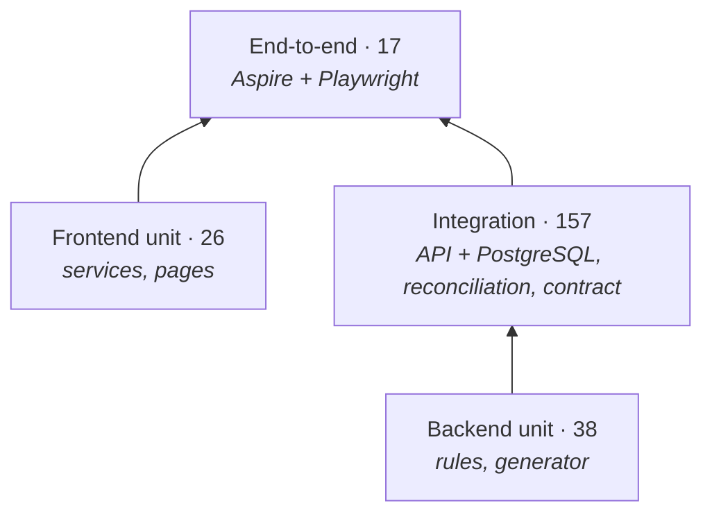

# Testing strategy

**238 automated tests at four levels**, all run by CI on every push. Each level answers a different
question. Together they show that the rules are right, that every endpoint returns what the
database holds, and that a user sees exactly that, live, in a real browser.

| Level | Project | Tests | Runtime | Proves |
|---|---|---|---|---|
| Backend unit | `tests/AssetDashboard.Tests` | 38 | < 1 s | Business rules and the data generator are correct |
| Backend integration | `tests/AssetDashboard.IntegrationTests` | 157 | ~50 s (3 Postgres containers) | Every endpoint works with every filter against real PostgreSQL; figures equal independent SQL; contract and documentation are complete; the simulator stays realistic over long runs |
| Frontend unit | `web/src/**/*.spec.ts` (Vitest) | 26 | ~1.5 s | State, live-update client and page logic behave correctly; 81% line coverage |
| End-to-end | `tests/AssetDashboard.EndToEndTests` | 17 | ~75 s incl. system start | The whole system works for a user in Chromium: journeys, screen vs database, real time, accessibility |



## Running the tests

```bash
dotnet test tests/AssetDashboard.Tests              # backend unit
dotnet test tests/AssetDashboard.IntegrationTests   # needs Docker
cd web && npm run test:ci                           # frontend unit + coverage (web/coverage)
dotnet test tests/AssetDashboard.EndToEndTests      # needs Docker; stop any running AppHost/API/ng serve first
```

## What each level covers

### Backend unit (38)

| Class | Tests | Covers |
|---|---|---|
| `AmortizationTests` | 5 | Installment with balloon, balance after full term, reference annuity value |
| `ValuationModelTests` | 9 | Depreciation by class, salvage floor, condition, never above list price, forced sale below market |
| `CreditRiskTests` | 5 | PD by grade and arrears, LGD from net forced sale value, expected loss |
| `RefinancingPolicyTests` | 8 | Decline rules (LTV, grade, rate cut, default), risk pricing, generated requests are consistent |
| `PortfolioGeneratorTests` | 7 | Deterministic per seed, realistic default rate and LTV, remarketing states, valuations |
| `PortfolioFilterTests` | 4 | Filter keys (SignalR groups), normalisation, filtering in memory |

### Backend integration (157)

Each test collection starts the real API (`WebApplicationFactory`) on a throwaway PostgreSQL 17
container (Testcontainers), migrates and seeds it. Tests that change data use their own database.

| Class | Tests | Covers |
|---|---|---|
| `EndpointMatrixTests` | 64 | 10 filterable endpoints × 6 filters (filter echoed and applied, CSV type); invalid parameters → 400; `/health` |
| `ReconciliationTests` | 26 | Hand-written SQL, independent of the app's queries, must equal the API: snapshot figures and breakdowns for 6 filters, asset list and LTV, history, refinancing, remarketing, auctions, vendors, sources |
| `DashboardApiTests` | 18 | Snapshot consistency, filters, assets list, sorting, detail, CSV export |
| `RealTimeAndSimulatorTests` | 12 | SignalR `SetFilter` returns the filtered snapshot; every simulator step runs against PostgreSQL |
| `RefinancingApiTests` | 8 | Summary, requests, candidates; SQL expected loss equals the domain rule per contract |
| `RemarketingApiTests` | 7 | Pipeline, ageing, recovery by channel, cost breakdown, auctions |
| `VendorApiTests` | 7 | Sorting, performance figures, vendor exposure sums to the portfolio, detail, 404 |
| `ApiDocumentationTests` | 4 | Every `/api` route documented (tag, summary, description, parameters); enums are strings; Swagger UI served |
| `HistoryApiTests` | 3 | Backfill length, totals equal the sum of classes, seam with today |
| `SourceApiTests` + `SourceFeedSimulatorTests` | 3 | Freshness, success rate, runs; loads run once per interval |
| `StatefulEndpointTests` | 2 | Simulator pause/resume; events endpoint keeps the last 50 |
| `LongRunSimulationTests` | 2 | 6,000 seeded simulator steps keep LTV, exposure, default, arrears and recovery rates in realistic bands, with no arrears older than the contract and no closed contract in arrears; 600 market shocks do not make values trend |
| `ApiContractTests` | 1 | The OpenAPI document equals the committed contract (`contracts/openapi.v1.json`) |

**Proven to catch errors:** changing the "30+ days past due" rule to 31+ made the reconciliation
tests fail with the exact difference (SCRUM-71). The integration tests also caught two query
errors (sorting on projected records) before they reached the screen.

### Frontend unit (26)

| Spec | Tests | Covers |
|---|---|---|
| `dashboard-hub.service.spec.ts` | 6 | Against a fake SignalR connection: filter sent on connect, change and reconnect; stale snapshots ignored; event cap |
| `filter.service.spec.ts` | 4 | Patch, drill-down toggle, chips with vendor names, reset |
| `overview.spec.ts` | 4 | KPIs from a snapshot, underwater flag and watchlist, drill-down clicks, signed event amounts |
| `assets.spec.ts` | 4 | Stale responses dropped, chips, sort resets paging, first load |
| `api.service.spec.ts` | 3 | Exact query parameters and URLs (HttpTestingController) |
| `format.spec.ts` | 3 | Euro, percent and count formatting; labels |
| `models.spec.ts` | 2 | Filter equality across null and missing fields |

The generated API types and compile-time checks in `models.ts` add a further guarantee at build
time: the frontend cannot compile against a stale API contract.

### End-to-end (17)

The whole system is started by the Aspire AppHost (PostgreSQL, API, Angular; fresh database) and
driven in Chromium with Playwright for .NET. The simulator is paused so figures hold still while
they are compared; the real-time test resumes it.

| Class | Tests | Covers |
|---|---|---|
| `OverviewTests` | 4 | All sections render; **headline figures on screen equal the database** (formatted with the app's own rules); drill-down by asset class and back; underwater-only |
| `AssetExplorerTests` | 4 | Filter carried from the overview and removed via its chip; LTV sort; detail panel; **CSV export contains exactly the filtered rows** |
| `RealTimeTests` | 2 | A server change reaches the screen in under 3 s (measured: event ~12 ms, refreshed figures 0.8–1.8 s); pause/resume buttons |
| `AccessibilityAndLayoutTests` | 7 | axe WCAG 2.1 A and AA on both pages, light and dark (0 violations); phone width never scrolls sideways; dark surfaces |

## Coverage by endpoint

| Endpoint | Functional | Filter matrix | Reconciled with SQL | Seen in the browser |
|---|---|---|---|---|
| `GET /api/dashboard/snapshot` | ✓ | ✓ | ✓ (6 filters) | ✓ (overview, drill-down) |
| `GET /api/dashboard/events` | ✓ | | | ✓ (live feed) |
| `GET /api/assets` | ✓ | ✓ | ✓ (totals, LTV) | ✓ (explorer, sort) |
| `GET /api/assets/export` | ✓ | ✓ | ✓ (row count) | ✓ (download) |
| `GET /api/assets/{id}` | ✓ | | | ✓ (detail panel) |
| `GET /api/history` | ✓ | | ✓ (today) | planned (Trends) |
| `GET /api/refinancing/summary` | ✓ | ✓ | ✓ | planned |
| `GET /api/refinancing/requests` | ✓ | ✓ | | planned |
| `GET /api/refinancing/candidates` | ✓ | ✓ | ✓ (EL rule) | planned |
| `GET /api/remarketing/summary` | ✓ | ✓ | ✓ | planned |
| `GET /api/remarketing/cases` | ✓ | ✓ | | planned |
| `GET /api/remarketing/auctions` | ✓ | ✓ | ✓ | planned |
| `GET /api/vendors` | ✓ | ✓ | ✓ | planned |
| `GET /api/vendors/{id}` | ✓ | | | planned |
| `GET /api/sources`, `/{id}/runs` | ✓ | | ✓ (±1 run) | planned |
| `GET /api/reference` | ✓ | | | ✓ (dropdowns) |
| `/api/simulator` (get, pause, resume) | ✓ | | | ✓ (buttons) |
| `/hubs/dashboard` (SignalR) | ✓ (`SetFilter`) | | | ✓ (real time) |

## Evidence each run leaves behind

| Artifact | Where | Use |
|---|---|---|
| Test results (TRX) | CI artifacts `backend-test-results`, `e2e-artifacts` | Pass/fail per test |
| Coverage | CI run summary; `coverage/` (backend), `web/coverage/` (frontend) | Coverage per file |
| Playwright traces | `e2e-artifacts/traces/*.zip` | Step-by-step replay of every end-to-end test (https://trace.playwright.dev) |
| Screenshots | `e2e-artifacts/screenshots/` | Overview light/dark, detail panel, phone layouts |
| Latency | `e2e-artifacts/latency.txt`, CI run summary | Server change → screen times |
| Accessibility | `e2e-artifacts/accessibility.txt`, CI run summary | axe results per page and theme |
| Traces and metrics | Aspire dashboard (`dotnet run --project src/AssetDashboard.AppHost`) | Live: snapshot recompute time per filter, SQL per request |

## Rules that keep the suite reliable

- **Real dependencies where they matter:** PostgreSQL in containers, never an in-memory database
  (it does not translate SQL); the whole system for end-to-end tests, not mocks.
- **Deterministic data:** seeded generators; the simulator paused while figures are compared;
  rolling time windows allow ±1 row.
- **Wait for the result, never for time:** end-to-end tests wait for a known outcome (e.g. the
  asset the API ranks first appearing as the top row), not for a fixed delay. An early version of
  the sort test read rows before the redraw and failed once in three runs; it now waits for the
  expected first row and passed 5 consecutive runs.
- **Isolation:** tests that change data run in their own collection and database.
- **One fact, one place:** reconciliation SQL is written by hand, independent of the application's
  LINQ, so a shared mistake cannot make both sides agree.

## Adding tests

- New business rule → unit test in `tests/AssetDashboard.Tests`.
- New endpoint → integration class (functional + filter matrix + reconciliation where it returns
  figures); the documentation and contract tests then require the endpoint's docs and a contract
  update (see the [backend guide](backend-guide.md#recipes)).
- New screen → a spec next to the component, and an end-to-end journey in
  `tests/AssetDashboard.EndToEndTests` with a screen-vs-database check for its headline figures;
  the accessibility test should list the new route.
